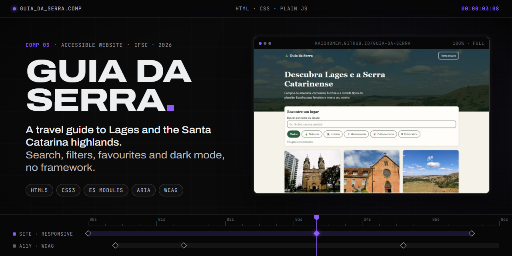
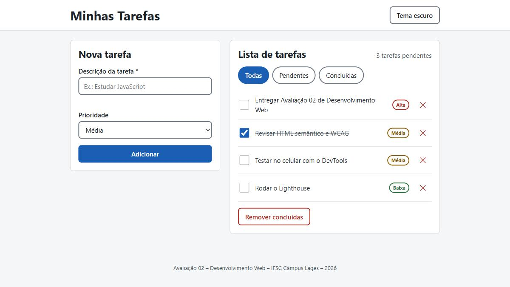

<div align="center">

**English** · [Português (Brasil)](README.pt-BR.md)

</div>



# Guia da Serra – Lages and the Santa Catarina Highlands

An accessible, responsive travel guide to **Lages and the Santa Catarina highlands** in southern Brazil, built with **plain HTML, CSS and JavaScript** only (no frameworks, no libraries).

Project for **Assessment 02 – Web Development** at **IFSC, Lages campus** (2026/2).

**🔗 Open the site: https://kaiohomem.github.io/guia-da-serra/**



## Features

- 9 places in Lages and the region, each with a photo, category, city and description
- Instant search by name or city (accent-insensitive: "urubici" finds "Urubici")
- Category filter: Nature, History, Food, Culture and leisure
- Favourites with a heart ♥ and a "Favourites only" filter
- Details window with a large photo, photo credit and a map link
- A form for visitors to suggest new places, with validation
- Favourites and suggestions saved in the browser (`localStorage`)
- Light and dark themes
- Effects: confetti when you favourite a place, cards that lift on hover, enter and exit animations, a floating toast

## Places in the guide

| Place | City | Category |
|---|---|---|
| Diocesan Cathedral of Lages | Lages | History |
| São José Franciscan Convent | Lages | History |
| Coxilha Rica | Lages | Nature |
| National Pine Nut Festival (Festa Nacional do Pinhão) | Lages | Food |
| Vidal Ramos Júnior Stadium (Tio Vida) | Lages | Culture and leisure |
| Serra do Rio do Rastro | Bom Jardim da Serra | Nature |
| Morro da Igreja and Pedra Furada | Urubici | Nature |
| Avencal Waterfall | Urubici | Nature |
| High-altitude vineyards | São Joaquim and region | Food |

## Technologies

| Technology | Used for |
|---|---|
| HTML5 | Semantic structure, `<dialog>` and ARIA attributes |
| CSS3 | Custom properties, Flexbox, auto-fill Grid, media queries, animations |
| JavaScript (ES Modules) | Logic, DOM manipulation, events, Web Animations API |

## Running it

The project uses JavaScript modules (`import`/`export`), so **it does not work by double-clicking `index.html`**: browsers block modules on local files (`file://`). You need a local server.

**Option 1 – VS Code:** install the *Live Server* extension, right-click `index.html` and choose *Open with Live Server*.

**Option 2 – Terminal (Python):**

```bash
python -m http.server 5500
```

Then open http://localhost:5500 in your browser.

## Project structure

```
├── index.html            Page structure
├── css/
│   └── style.css         Styles, themes and responsiveness
├── js/
│   ├── main.js           Entry point: events and application state
│   ├── dados.js          List of places (array of objects)
│   ├── regras.js         Search, filters, favourites and validation (no DOM access)
│   ├── interface.js      Builds the cards and the details window
│   ├── armazenamento.js  Saves to and loads from localStorage
│   └── efeitos.js        Animations and visual effects
├── img/                  Photos of the places (Wikimedia Commons)
└── docs/
    ├── screenshot.jpg
    └── apresentacao.md   Presentation script
```

Each JavaScript file is a **module** with a single responsibility. The code comments are in Portuguese.

## Assessment requirements

### Usability and accessibility (WCAG)

- "Skip to main content" link, visible when navigating with Tab
- Always-visible focus (`:focus-visible`), and the whole interface works with the keyboard alone
- **Alternative text (`alt`) describing every photo**
- Details window built on `<dialog>`: traps focus, closes with Esc and returns focus to the button that opened it
- Search marked with `role="search"`; results announced with `aria-live`
- Filter and favourite buttons use `aria-pressed` (screen readers say whether they are on)
- Form with `<label>`s, errors tied to their fields (`aria-describedby`, `aria-invalid`) and focus moved to the first error
- The map link says it opens in a new tab
- Categories shown with text, not only colour
- Buttons with a minimum 44px touch target
- Animations turned off when the system asks for reduced motion (`prefers-reduced-motion`)

### Semantic HTML

`header`, `main`, `section` with `aria-labelledby`, an `article` per card, `ul`/`li`, `form`, `label`, `dialog`, `figure`/`figcaption`, `dl`/`dt`/`dd`, `footer`; headings in order (`h1` > `h2` > `h3`); `lang="pt-BR"`.

### Responsive design

- Mobile-first: the base CSS targets phones
- Cards with `grid-template-columns: repeat(auto-fill, minmax(260px, 1fr))`: 1 column on phones, 2 on tablets, 3 on desktop, with no media query
- `@media (min-width: 700px)` and `(min-width: 1000px)`: the form switches to 2 and 3 columns
- Title sized with `clamp()` so it grows with the screen; font sizes in `rem`
- Photos with `object-fit: cover` and `loading="lazy"`

### JavaScript

- Variables (`const`, `let`) and operators (`===`, `&&`, `||`, `!`, ternary, spread `...`)
- Functions and arrow functions
- Objects (each place is an object) and arrays (`filter`, `find`, `includes`, `forEach`, `map`)
- ES modules (`import` / `export`)
- DOM manipulation, event delegation and `<dialog>` with `showModal()`
- `localStorage` with JSON
- `async` / `await` and Promises in the animations

## Security

The site is static (no server, database or passwords), but the JavaScript treats everything that comes from the user or from `localStorage` as untrusted:

- **XSS protection:** typed text always goes into the page through `textContent`, never `innerHTML`. A name like `` shows up as plain text.
- **Content-Security-Policy:** the page only runs scripts and loads images and styles from its own files (`'self'`).
- **`localStorage` data is validated:** `JSON.parse` sits inside `try/catch` (corrupted data cannot break the site); suggestions and favourites are checked field by field; category and theme only accept known values.
- **Length limits** are enforced in JavaScript, not only by `maxlength` in the HTML.
- External links use `rel="noopener"` and a `referrer` policy.
- No passwords, API keys or personal data in the code.

> Note: the *Live Server* extension injects its own script to reload the page. The Content-Security-Policy blocks it, so a warning shows up in the console and the page does not reload by itself on save (just press F5). This does not happen with `python -m http.server`.

## Accessibility audit

| Tool / technique | Result |
|---|---|
| axe-core 4.10 (the engine behind axe DevTools) | 0 violations, 46 rules passed (WCAG 2.0/2.1 A and AA), in light and dark themes and in the details window |
| Contrast – body text | 14.6:1 (light) and 14.2:1 (dark). Minimum: 4.5:1 |
| Contrast – buttons | 7.5:1 (light) and 10:1 (dark) |
| Contrast – field borders | 4.4:1 (light) and 5.1:1 (dark). Minimum: 3:1 (criterion 1.4.11) |
| Keyboard | Tab, Shift+Tab, Enter, Space and Esc work across the whole interface |
| Responsive | Tested at 375px (phone) and desktop, with no horizontal scrolling |

## Photo credits

All photos come from [Wikimedia Commons](https://commons.wikimedia.org) and were resized to 800px wide.

| Photo | Author | License |
|---|---|---|
| [Catedral Diocesana de Lages](https://commons.wikimedia.org/wiki/File:Catedral_Diocesana_de_Lages.jpg) | Filipeschaves | CC BY-SA 4.0 |
| [Convento Franciscano São José](https://commons.wikimedia.org/wiki/File:Convento_Franciscano_S%C3%A3o_Jos%C3%A9_-_LAGES.jpg) | Dee Becker | CC BY-SA 4.0 |
| [Coxilha Rica](https://commons.wikimedia.org/wiki/File:Vista_da_Coxilha_Rica,_com_destaque_para_o_Viaduto_Ferrovi%C3%A1rio_Rio_Tatetos_(02-05-2020).jpg) | Gibbneckel | CC BY-SA 4.0 |
| [Pinhão](https://commons.wikimedia.org/wiki/File:Pinh%C3%A3o_(Garfada).jpg) | Marcelo Träsel | CC BY-SA 2.0 |
| [Estádio Tio Vida](https://commons.wikimedia.org/wiki/File:3_7_2021_-_Entardecer_no_Tio_Vida_(51330130575).jpg) | Inter de Lages | CC BY 2.0 |
| [Serra do Rio do Rastro](https://commons.wikimedia.org/wiki/File:Serra_do_Rio_do_Rastro_2019.jpg) | Fernandokaiserbr | CC BY-SA 4.0 |
| [Morro da Igreja e Pedra Furada](https://commons.wikimedia.org/wiki/File:Morro_da_Igreja_-_Pedra_Furada_-_Zoom.jpg) | AlexandreMachado | CC BY-SA 4.0 |
| [Cascata do Avencal](https://commons.wikimedia.org/wiki/File:Cascata_do_Avencal-_Urubici-_SC_01.jpg) | Elaine Alessio | CC BY-SA 4.0 |
| [Vinhedos da Serra Catarinense](https://commons.wikimedia.org/wiki/File:Vinhedos_da_Serra_Catarinense_01.jpg) | Elaine Alessio | CC BY-SA 4.0 |

## Author

**Kaio Homem** – [@KaioHomem](https://github.com/KaioHomem)

Federal Institute of Santa Catarina (IFSC) – Lages campus

## License

The code is under the MIT license (see [LICENSE](LICENSE)). The photos in `img/` keep their authors' Creative Commons licenses, listed above.
